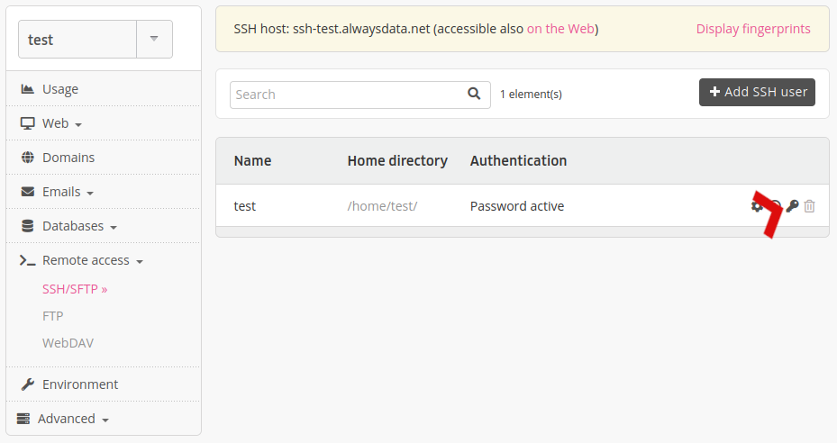
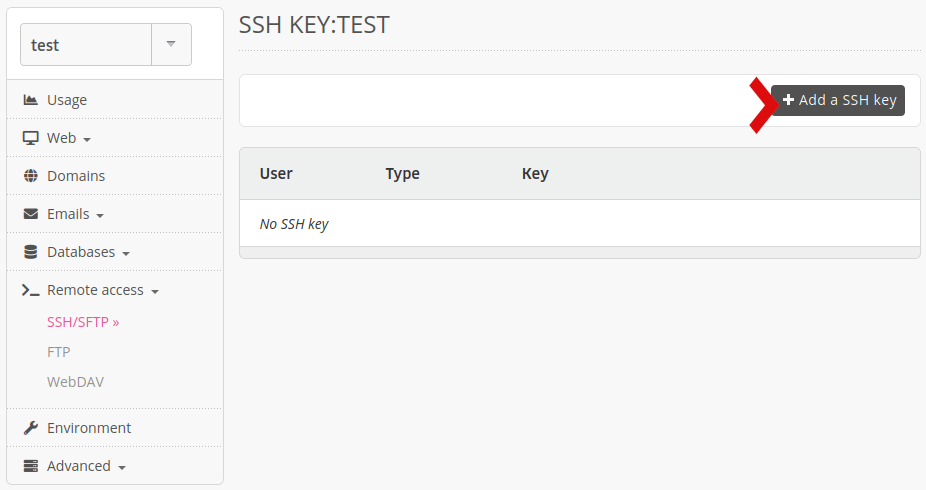

Connecting in SSH mode with its public key (with or rather than use the connection via password) offers some advantages: enhanced security, the ability to define a "blank" password, etc. Here are the steps to follow to configure your SSH account with a public key.

> [!NOTE]
> DSA keys are [not accepted](https://www.openssh.com/legacy.html).

## Generate the private key

### In Windows

The actions are performed using *PuTTY*, an SSH client [available free of charge](https://www.chiark.greenend.org.uk/~sgtatham/putty/download.html).

- Start **PuTTYGen** (supplied by PuTTy),
- Generate a pair of **SSH-2 ED25519** keys,
- Save the private key on your station.

### In Unix / OS X

```sh
$ mkdir -p $HOME/.ssh
$ chmod 0700 $HOME/.ssh
$ ssh-keygen -t ed25519 -f $HOME/.ssh/id_ed25519
```

> [!TIP]
> To never have to enter your password when connecting in SSH mode, specify a blank "passphrase".

## Declare the SSH key on the server

Navigate to the **Remote Access > SSH/SFTP > SSH Keys - 🔑** menu of the desired **SSH user**.



Then click on **Add a SSH Key**.



> [!TIP]
> Users of the [Private Cloud](/en/docs/admin-billing/billing/choose-its-paas) can declare [global keys to the server](/en/docs/web-hosting/remote-access/ssh/install-globally-ssh-keys), which can be used by all accounts.
