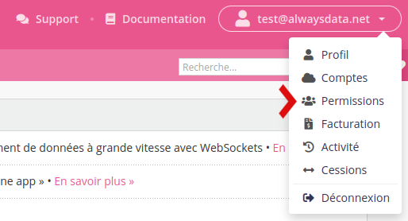

Parce que l'hébergement de vos données implique très souvent différents acteurs, notre interface d'administration vous
permet d'octroyer des permissions sur différents niveaux de granularité.

Vous pouvez paramétrer les permissions via le menu **Permissions** de votre espace client.

## Permissions globales

- **Gestion des comptes** : délègue l'ouverture de comptes à vos associés (menu *Abonnements*)  ;
- **[Facturation](/fr/docs/admin-facturation/facturation/)** : permet aux services comptables ou administratifs de
  recevoir une alerte lorsque le solde de votre compte est négatif ou lors de l'ouverture d'un ticket concernant la
  facturation par nos services et de payer les factures, acheter/renouveler/transférer les domaines (menu *Facturation*)
  ;
- **Technique au niveau des comptes** : permet aux équipes techniques de gérer l'aspect purement technique de votre
  hébergement (sites, emails, bases de données...) sans se soucier de sa gestion et facturation ;
- **Technique au niveau des serveurs** : disponible sur [Cloud
  Privé](/fr/docs/admin-facturation/facturation/prix-cloud-prive/), votre administrateur réseau pourra gérer règles de
  firewall, queue d'envoi des emails et bien d'autres...

## Permissions techniques

Que ce soit pour l'aspect purement technique de vos comptes ou de vos serveurs, votre organisation impose un découpage
des responsabilités techniques en interne entre plusieurs personnes ou groupes de personnes ou entre sous-traitants
externes qui ont besoin d'accès même restreints. Vous pouvez donc définir des permissions par **service** et par
**compte** ou **serveur**.

### Par compte

À partir du moment où un profil a des permissions sur le compte, il a accès au menu *Statut des serveurs*.

- **Contact technique** : soyez alerté lors de l'ouverture d'un ticket technique par nos services concernant le compte ;
- **Consommation** : suivez la consommation du compte (menus *Consommation*, *Avancé > Logs*) ;
- **Ressources** : permission pour les comptes sur [Cloud
  privé](/fr/docs/admin-facturation/facturation/prix-cloud-prive/) permet de gérer les
  [sondes](/fr/docs/hebergement-web/sites/personnalisation/utiliser-les-sondes-de-monitoring/) (menu *Web > Sondes*) et
  [ressources](/fr/docs/caracteristiques-techniques/ressources-systemes-alertes-et-limitations/) (menu *Avancé >
  Ressources*) ;
- **[Statistiques](/fr/docs/hebergement-web/statistiques/)** : analysez les visites de vos sites (menu *Web >
  Analytics*)  ;
- **[Sites](/fr/docs/hebergement-web/sites/)** : configurez les sites web et l'environnement Apache (menus *Web >
  Sites*, *Web > Configuration*) ;
- **[Domaines](/fr/docs/domaines/)** : gérez techniquement les domaines et leurs DNS (menu *Domaines*). Pour toutes les
  opérations facturables, il faudra aussi les permissions **Facturation** sur le profil propriétaire ;
- **[Emails](/fr/docs/emails/)** (menus *Emails > Adresses*, *Emails > Listes de diffusion*, *Emails > Configuration*) ;
- **[Historique des emails envoyés](/fr/docs/emails/emails-sortants/verifier-l-envoi-d-un-email/)** (menu *Emails >
  Historique*) ;
- **[Bases de données](/fr/docs/hebergement-web/bases-de-donnees/)** (menu *Bases de données*) ;
- **[FTP](/fr/docs/hebergement-web/acces-distant/ftp/)** (menu *Accès distant > FTP*) ;
- **[SSH](/fr/docs/hebergement-web/acces-distant/ssh/)** (menu *Accès distant > SSH*) ;
- **[WebDAV](/fr/docs/hebergement-web/acces-distant/webdav/)** (menu *Accès distant > WebDAV*) ;
- **[Environnement](/fr/docs/hebergement-web/langages/)** : configurez les langages de programmation (menu
  *Environnement*) ;
- **Processus** : processus en cours d'exécution pouvant être analysés ou tués (menu *Avancé > Processus*) ;
- **[Adresses IP](/fr/docs/hebergement-web/adresses-ip-dediees/)** : louer des IP dédiées pour HTTP ou SMTP (menu
  *Avancé > Adresses IP*) ;
- **[Certificats SSL](/fr/docs/hebergement-web/sites/ssl-tls)** (menu *Avancé > Certificats SSL*) ;
- **[Migration](/fr/docs/caracteristiques-techniques/migrations/)** (menu *Avancé > Migrations*) ;
- **[Tâches planifiées](/fr/docs/hebergement-web/taches-planifiees/)** (menu *Avancé > Tâches planifiées*) ;
- **[Sauvegardes](/fr/docs/hebergement-web/sauvegardes/)** (menu *Avancé > Restauration de sauvegardes*) ;
- **[Services](/fr/docs/hebergement-web/services/)** (menu *Avancé > Services*).

### Par serveur

À partir du moment où un profil a des permissions sur le serveur, il a accès au menu *Configuration*.

- **Contact technique** : soyez alerté lors de l'ouverture d'un ticket technique par nos services concernant un serveur
  ;
- **[Utilisateurs SSH](/fr/docs/hebergement-web/acces-distant/ssh/cles-ssh-globales/)** : installez des clés SSH pour un
  accès simplifié aux différents comptes (menu *Clés SSH*) ;
- **[Règles firewall](/fr/docs/caracteristiques-techniques/configurer-le-firewall/)** : créez des règles firewall et
  consultez le bannissement automatique d'IP au niveau du serveur  (menu *Firewall*) ;
- **Configuration SMTP** : gérez la queue d'envoi d'emails, le relais SMTP et le score de spam (menu *SMTP*) ;
- **Utilisateurs base de données** : donnez un accès global aux bases de données de l'ensemble des comptes (menu
  *Utilisateurs MySQL*) ;
- **Configuration SSL** : choisissez le certificat SSL à retourner sur le serveur (`*.alwaysdata.net` par défaut) et la
  [configuration TLS](/fr/docs/hebergement-web/sites/ssl-tls/configurer-tls/) du serveur (menu *SSL*) ;
- **Configuration HTTP** : choisissez un site web qui sera la [page d'accueil par
  défaut](/fr/docs/hebergement-web/sites/divers/#site-http-par-defaut) et la [période de rétention des
  logs](/fr/docs/hebergement-web/acces-distant/repertoire-admin/#logs) (menu *HTTP*) ;
- **Consommation** : accédez à un ensemble d'informations sur votre serveur (menus Comptes, Statut du serveur). Pour
  ouvrir des comptes sur le serveur il sera nécessaire d'avoir la permission **Gestion des comptes** sur le profil
  propriétaire ;
- **[Ressources](/fr/docs/caracteristiques-techniques/ressources-systemes-alertes-et-limitations/)** : modifiez les
  limitations de ressources par compte - RAM, CPU, espace disque (menu *Ressources*) ;
- **[Migration](/fr/docs/caracteristiques-techniques/migrations/)** (menu *Migrations*).

## 2FA nécessaire

Lorsque la case **2FA nécessaire** est cochée, l'utilisateur en question doit se connecter [avec 2
facteurs](/fr/docs/admin-facturation/profil/authentification-2-facteurs/) pour accéder aux menus auxquels on lui a donné
accès.

## Mes permissions

Il est possible de supprimer les permissions que nous avons sur d'autres profils via le menu **Permissions > Mes
permissions**. La suppression ne s'effectue pas finement : elles sont toutes supprimées.

## Divers

En créant des permissions à une adresse email n'ayant pas de profil alwaysdata, cette personne recevra un email pour
initialiser son profil.
