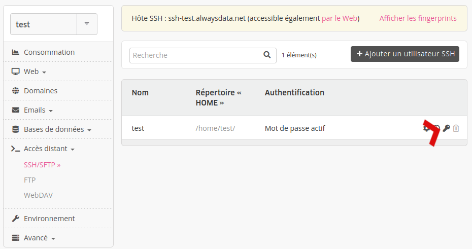
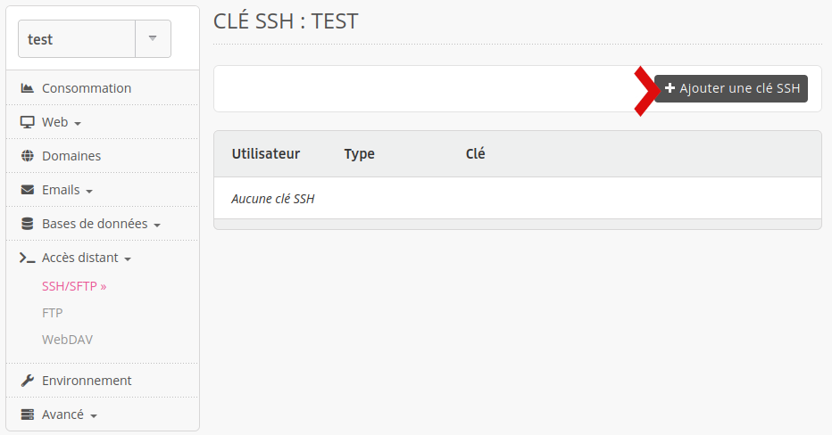

Se connecter en SSH avec sa clé publique (avec ou en désactivant la connexion par mot de passe) présente quelques avantages : sécurité renforcée, possibilité de définir un mot de passe "vide", etc. Voici les étapes à suivre pour configurer son compte SSH avec clé publique.

> [!NOTE]
> Les clés DSA ne sont [pas acceptées](https://www.openssh.com/legacy.html).

## Générer sa clé privée 

### Sous Windows

Les manipulations sont réalisées grâce à *PuTTY*, un client SSH [disponible gratuitement](https://www.chiark.greenend.org.uk/~sgtatham/putty/download.html).

- Lancez **PuTTYGen** (fourni par PuTTy) ;
- Générez une paire de clés **SSH-2 ED25519** ;
- Sauvegardez la clé privée sur votre poste ;

### Sous Unix / OS X

```sh
$ mkdir -p $HOME/.ssh
$ chmod 0700 $HOME/.ssh
$ ssh-keygen -t ed25519 -f $HOME/.ssh/id_ed25519
```

> [!TIP] Astuce
> Si vous voulez ne jamais avoir à rentrer votre mot de passe lorsque vous vous connecterez en SSH, indiquez une « passphrase » vide.

## Déclarer la clé SSH sur le serveur

Rendez-vous dans le menu **Accès distant > SSH/SFTP > Clés SSH - 🔑** de l'**utilisateur SSH** voulu.



Puis cliquez sur **Ajouter une clé SSH**.



> [!TIP] Astuce
> Les utilisateurs du [Cloud Privé](/fr/docs/admin-facturation/facturation/choisir-son-plan/) peuvent déclarer [des clés globales au serveur](/fr/docs/hebergement-web/acces-distant/ssh/cles-ssh-globales/), utilisables par tous les comptes.
